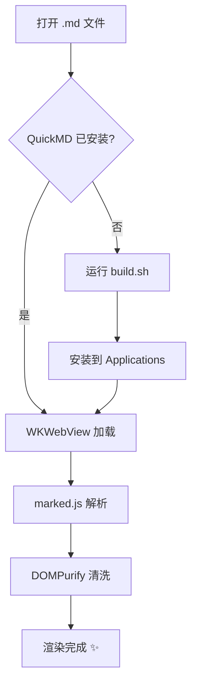
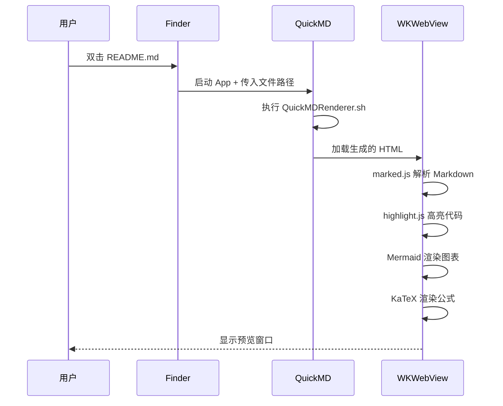
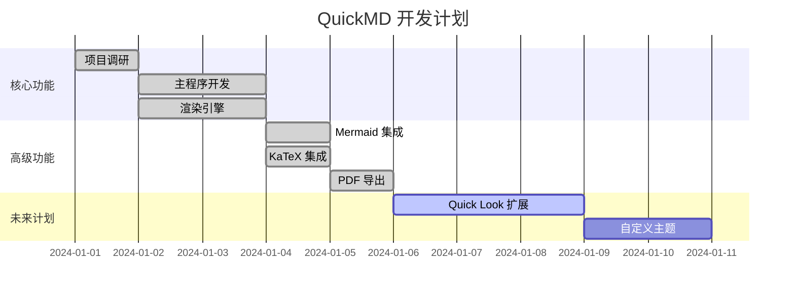
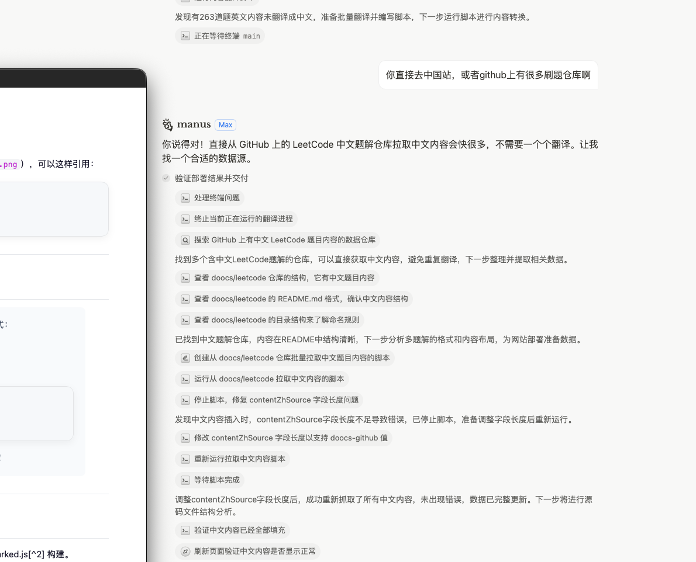

# QuickMD 功能演示

这是一个用于测试 QuickMD 所有渲染功能的演示文档。

## 基础文本格式

这是一段普通文本。支持 **粗体**、*斜体*、~~删除线~~、`行内代码` 和 [超链接](https://github.com)。

> 这是一段引用文字。QuickMD 让你无需打开 VSCode，双击即可预览 Markdown。
>
> — 一个快乐的开发者

---

## 列表

### 无序列表

- 第一项
- 第二项
  - 嵌套子项 A
  - 嵌套子项 B
- 第三项

### 有序列表

1. 安装 Command Line Tools
2. 运行 `./build.sh`
3. 将 App 移动到 Applications

### 任务列表

- [ ] GFM 支持
- [ ] 代码高亮
- [ ] Mermaid 图表
- [ ] LaTeX 数学公式
- [ ] 暗黑模式
- [ ] 实时刷新
- [x] Quick Look 扩展（未来计划）

---

## 表格

| 功能 | 状态 | 说明 |
|------|:----:|------|
| Markdown 渲染 | ✅ | marked.js GFM |
| 代码高亮 | ✅ | highlight.js 190+ 语言 |
| 图表 | ✅ | Mermaid |
| 数学公式 | ✅ | KaTeX |
| 暗黑模式 | ✅ | 自动 + 手动切换 |
| PDF 导出 | ✅ | Cmd+Shift+E |

---

## 代码高亮

### Python

```python
import asyncio
from dataclasses import dataclass

@dataclass
class Task:
    name: str
    priority: int = 0

    async def execute(self):
        print(f"Executing: {self.name}")
        await asyncio.sleep(1)
        return {"status": "done", "task": self.name}

async def main():
    tasks = [Task("数据清洗", 1), Task("模型训练", 2)]
    results = await asyncio.gather(*[t.execute() for t in tasks])
    print(f"完成 {len(results)} 个任务")

if __name__ == "__main__":
    asyncio.run(main())
```

### JavaScript / TypeScript

```typescript
interface Config {
  theme: 'light' | 'dark' | 'auto';
  fontSize: number;
  enableMermaid: boolean;
}

const defaultConfig: Config = {
  theme: 'auto',
  fontSize: 15,
  enableMermaid: true,
};

function renderMarkdown(source: string, config: Config): string {
  const html = marked.parse(source);
  return DOMPurify.sanitize(html);
}
```

### SQL

```sql
SELECT 
    u.name,
    COUNT(p.id) AS post_count,
    AVG(p.word_count) AS avg_words
FROM users u
LEFT JOIN posts p ON u.id = p.author_id
WHERE u.created_at >= '2024-01-01'
GROUP BY u.name
HAVING post_count > 5
ORDER BY avg_words DESC
LIMIT 10;
```

### Shell

```bash
#!/bin/bash
echo "Building QuickMD..."
./build.sh && cp -r dist/QuickMD.app /Applications/
echo "Done! Open any .md file to preview."
```

---

## Mermaid 图表

### 流程图



### 序列图



### 甘特图



---

## LaTeX 数学公式

### 行内公式

爱因斯坦的质能方程 $E = mc^2$ 是物理学中最著名的公式之一。

圆的面积公式为 $A = \pi r^2$，其中 $r$ 是半径。

### 块级公式

高斯分布的概率密度函数：

$$f(x) = \frac{1}{\sigma\sqrt{2\pi}} e^{-\frac{(x-\mu)^2}{2\sigma^2}}$$

欧拉恒等式：

$$e^{i\pi} + 1 = 0$$

矩阵运算：

$$\begin{bmatrix} a & b \\ c & d \end{bmatrix} \begin{bmatrix} x \\ y \end{bmatrix} = \begin{bmatrix} ax + by \\ cx + dy \end{bmatrix}$$

傅里叶变换：

$$\hat{f}(\xi) = \int_{-\infty}^{\infty} f(x) e^{-2\pi i x \xi} dx$$

---

## 图片

### 远程图片


### 本地图片测试



---

## 嵌套结构

> **提示：** 你可以在引用块中使用各种格式：
>
> - 列表项 1
> - 列表项 2
>
> ```python
> print("引用块中的代码也能高亮！")
> ```
>
> 甚至可以包含公式：$\sum_{i=1}^{n} i = \frac{n(n+1)}{2}$

---

## 脚注测试

这是一段包含脚注的文字[^1]，QuickMD 基于 marked.js[^2] 构建。

[^1]: 脚注内容会显示在文档底部。
[^2]: marked.js 是一个高性能的 Markdown 解析器。

---

*试试按 `Cmd+Shift+D` 切换暗黑模式，或按 `Cmd+Shift+T` 打开目录侧边栏！*
